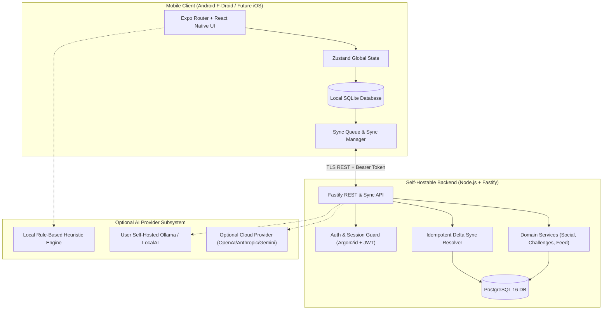
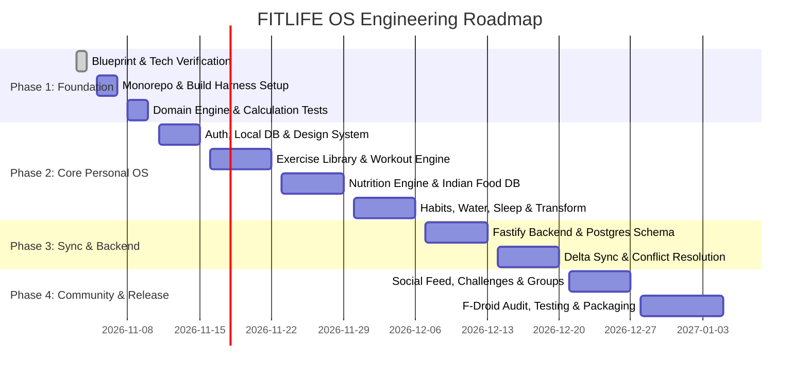

# FITLIFE OS — MASTER SYSTEM BLUEPRINT
**Document Identifier:** FLOS-MSB-001  
**Status:** PROPOSED & READY FOR APPROVAL  
**Version:** 1.0.0-draft  
**Last Updated:** November 3, 2026  
**License:** Apache License 2.0  
**Repository:** https://github.com/karthikcmani/fitlife-os  

---

## 1. EXECUTIVE SUMMARY & PRODUCT VISION

### 1.1 Vision Statement
**FITLIFE OS** is an open-source, private-by-design, local-first personal health and fitness operating system. It bridges the gap between commercial, polished fitness applications (such as Hevy, MyFitnessPal, Whoop, and Strava) and the ethos of free software: 100% self-hostable, zero proprietary tracker lock-in, free from mandatory paid subscriptions or proprietary cloud dependencies, and packaged for F-Droid without proprietary Google Play Services dependencies.

FITLIFE OS treats fitness as a holistic, interconnected feedback loop:
$$\text{Fitness Journey} = \text{Workouts} \times \text{Nutrition} \times \text{Recovery} \times \text{Habits} \times \text{Accountability}$$

If any dimension is neglected, long-term health outcomes degrade. FITLIFE OS coordinates all five domains within a unified mobile client and self-hostable backend.

### 1.2 Core Product Pillars
1. **Uncompromising Data Ownership & Privacy:** Biometrics, workout logs, nutritional intake, and especially body transformation photos belong entirely to the user. Local-first storage guarantees complete offline utility. No cloud telemetry, no analytics beacons, and no ad SDKs.
2. **First-Class Indian & Global Nutritional Support:** Most global nutrition apps fail Indian users by misrepresenting regional carbohydrate, protein, and fat breakdowns, cooking mediums (ghee, mustard oil, coconut oil), and domestic portion metrics (katori, roti, piece). FITLIFE OS integrates standard nutritional frameworks (including ICMR-NIN Indian Food Composition Tables) alongside USDA and global databases.
3. **Rigorous Physiological Science:** Workout progressions, Basal Metabolic Rate (BMR), Total Daily Energy Expenditure (TDEE), and macro targets adhere to validated peer-reviewed exercise physiology (Mifflin-St Jeor, Katch-McArdle, Brzycki 1RM, Progressive Overload heuristics). Estimates are never presented as measured facts.
4. **F-Droid First-Class Citizenship:** Built strictly with reproducible, free-and-open-source software (FOSS). No binary blobs, no mandatory Google Play Services, and no proprietary AI vendor vendor-locks.
5. **Community without Toxicity:** Social accountability through opt-in peer groups, challenges, and shared streaks without aggressive social algorithms, vanity metrics, or forced public exposure of private body measurements.

---

## 2. GOVERNANCE & BLUEPRINT AUTHORITY RULES

This document is the **authoritative master specification** for FITLIFE OS.

1. **Mandatory Pre-Reading:** All developers and autonomous AI agents must read this blueprint before implementing features or modifying architectural boundaries.
2. **Requirement Inviolability:** Never silently alter, weaken, remove, or substitute an approved requirement.
3. **Change Proposal Protocol:** Any deviation from the technology stack, database architecture, privacy boundaries, or functional scope requires a written Change Proposal in `docs/CHANGE_DECISIONS.md`:
   - Decision ID (e.g., `DEC-2026-001`)
   - Existing specification
   - Proposed modification
   - Justification & evidence
   - Impact assessment (Security, Performance, F-Droid compliance, Offline sync, Migration)
   - Explicit human sign-off status
4. **Ambiguity Resolution:** In the presence of ambiguities, ask the human maintainer rather than inventing major behavioral or architectural defaults.
5. **Verifiable Truth in Progress:** Code and tests must be physically executed. Features in development must present clear status indicators and never mock production outcomes.

---

## 3. TARGET PERSONAS & USER JOURNEYS

### 3.1 User Personas
* **Persona A: "Arun" (The Indian Tech Professional / Recomposition Beginner)**
  - *Context:* Works long hours in Bangalore, eats home-cooked South Indian meals (idli, dosa, sambar, rice, curd), wants to reduce visceral fat and gain lean muscle.
  - *Needs:* Accurate Indian food logging with regional measures; home/gym bodyweight-to-dumbbell progressive plans; offline logging when cellular connection is spotty.
* **Persona B: "Maya" (The Intermediate Strength Lifter / Gym Enthusiast)**
  - *Context:* Trains 4–5 days/week in a commercial gym following an Upper/Lower or PPL split.
  - *Needs:* Plate calculator, precise RPE tracking, warm-up set calculations, 1RM progression charts, rest timer with sound/haptic alerts, superset support.
* **Persona C: "David" (The Privacy & FOSS Advocate / Self-Hoster)**
  - *Context:* Uses GrapheneOS / ungoogled Android, installs only via F-Droid, runs a home homelab on TrueNAS/Docker.
  - *Needs:* Zero proprietary Google Play Services dependencies; local SQLite database; seamless self-hosted sync with private Fastify+Postgres instance.

### 3.2 Primary User Journeys
1. **Onboarding & Profile Calibration:** User sets physiological specs, experience level, goal (fat loss, recomp, muscle gain, maintenance), equipment access, and dietary preferences $\rightarrow$ App calculates baseline BMR/TDEE with clear disclaimers $\rightarrow$ Generates an initial starter routine.
2. **Active Workout Execution:** User starts scheduled session $\rightarrow$ Views exercise instructions, previous performance, and target weight/reps $\rightarrow$ Logs completed sets $\rightarrow$ System triggers rest timer with haptic alerts $\rightarrow$ Calculates volume, sets personal records (PRs), and stages changes for local SQLite and sync queue.
3. **Meal & Nutrient Logging:** User searches for food items (e.g., "Masala Dosa" or "Moong Dal Tadka") $\rightarrow$ Selects standard portion or custom gram weight $\rightarrow$ Macro progress bar updates instantly $\rightarrow$ Daily micronutrient/macro totals calculate locally.
4. **Offline Logging & Conflict-Free Sync:** User works out in an underground gym with zero signal $\rightarrow$ Logs full workout and post-workout meal $\rightarrow$ Connectivity restores $\rightarrow$ Sync queue transmits changes with Lamport timestamps and idempotent batch payloads $\rightarrow$ Cloud state harmonizes without loss.

---

## 4. FUNCTIONAL REQUIREMENTS MATRIX

| Domain | Feature ID | Functional Requirement | Local/Offline | Server Sync |
|---|---|---|---|---|
| **Auth & Profile** | AUTH-01 | Email/Password registration with Argon2id | Cached Session | Required for Setup |
| | AUTH-02 | Local profile caching and offline session persistence | Mandatory | On Reconnect |
| | PROF-01 | Comprehensive physiological profile & goal setting | Full | Synchronized |
| **Workouts** | WKT-01 | Standard categorized exercise library (500+ movements) | Bundled SQLite | Sync Updates |
| | WKT-02 | Live workout logger (Sets, Reps, Weight, RPE, Rest Timer) | 100% Offline | Queued Sync |
| | WKT-03 | Routine builder & automated split generator (PPL, Upper/Lower, Full Body) | 100% Offline | Synchronized |
| | WKT-04 | PR detection & 1RM calculation (Brzycki / Epley) | 100% Offline | Synchronized |
| **Nutrition** | NUT-01 | Comprehensive food database with deep Indian food taxonomy | Bundled + Local Cache | Sync Custom Foods |
| | NUT-02 | Meal logger (Breakfast, Lunch, Dinner, Snacks) with gram precision | 100% Offline | Queued Sync |
| | NUT-03 | Metabolic Engine (BMR/TDEE/Macro distribution) | 100% Offline | Synchronized |
| | NUT-04 | Custom recipe builder & nutritional summing | 100% Offline | Synchronized |
| **Habits & Vitals**| HAB-01 | Custom daily habits with streaks and flexible schedules | 100% Offline | Synchronized |
| | HYD-01 | Hydration tracker with custom volume presets & daily target | 100% Offline | Queued Sync |
| | SLP-01 | Sleep logging (Bedtime, Wake time, Subjective Quality, Consistency) | 100% Offline | Queued Sync |
| **Transformation**| TRN-01 | Body metric tracking (Weight, Waist, Chest, Arms, Thighs, Hips) | 100% Offline | Queued Sync |
| | TRN-02 | Private progress photo vault with biometric lock / local encryption | Private Offline | Opt-in Encrypted Sync |
| **Analytics** | ANL-01 | Volume, frequency, macro trends, and weight moving average charts | 100% Offline | Client Computed |
| **Community** | COM-01 | Opt-in friend relationships, activity feed, and challenges | Offline Read Cache | Network Required |
| | COM-02 | Group accountability and community challenges | Read Cache | Network Required |
| **AI Assistant** | AI-01 | Rule-based offline heuristic assistant | 100% Offline | Optional Local Model |
| | AI-02 | Optional BYOK (Bring Your Own Key) or self-hosted LLM proxy | Graceful Fallback | User-Configured |

---

## 5. MATHEMATICAL & ALGORITHMIC SPECIFICATIONS

### 5.1 Metabolic Calculations (Nutrition Engine)

#### Basal Metabolic Rate (BMR)
Default to the validated **Mifflin-St Jeor** formula:
$$\text{BMR}_{\text{male}} = 10 \times \text{weight (kg)} + 6.25 \times \text{height (cm)} - 5 \times \text{age (y)} + 5$$
$$\text{BMR}_{\text{female}} = 10 \times \text{weight (kg)} + 6.25 \times \text{height (cm)} - 5 \times \text{age (y)} - 161$$

When body fat percentage ($BF\%$) is provided by user (via DXA or caliper measurements), provide the **Katch-McArdle** equation as an option:
$$\text{LBM (Lean Body Mass)} = \text{weight (kg)} \times \left(1 - \frac{BF\%}{100}\right)$$
$$\text{BMR} = 370 + (21.6 \times \text{LBM})$$

#### Total Daily Energy Expenditure (TDEE)
$$\text{TDEE} = \text{BMR} \times \text{Activity Multiplier}$$
* Sedentary (desk job, minimal movement): $1.200$
* Lightly Active (1–3 exercise days/week or 6,000 steps/day): $1.375$
* Moderately Active (3–5 exercise days/week or 9,000 steps/day): $1.550$
* Very Active (6–7 heavy training sessions/week): $1.725$
* Extremely Active (Athletic double sessions/manual labor): $1.900$

#### Goal Calorie Adjustments
* **Fat Loss:** Moderate deficit of $-15\%$ to $-25\%$ of TDEE (maximum safe deficit rate: $\le 1.0\%$ body weight loss per week to spare lean mass).
* **Muscle Gain (Hypertrophy):** Lean surplus of $+5\%$ to $+10\%$ of TDEE (targeting $0.25\%$ to $0.5\%$ body weight gain per month for trained individuals).
* **Body Recomposition:** TDEE $\pm 0\%$ (maintenance calories) with high protein intake.
* **Maintenance:** Equal to calculated TDEE.

#### Macronutrient Distribution Rules
* **Protein:**
  - Hypertrophy / Recomposition / Fat Loss: $1.6\text{ g/kg}$ to $2.2\text{ g/kg}$ of total bodyweight (or $2.2\text{ g/kg}$ to $2.6\text{ g/kg}$ of LBM if obese).
  - General Health / Maintenance: $1.2\text{ g/kg}$ to $1.6\text{ g/kg}$.
* **Dietary Fats:**
  - Essential hormonal minimum: $0.7\text{ g/kg}$ to $1.0\text{ g/kg}$ of bodyweight (typically $20\%$ to $30\%$ of total calories).
* **Carbohydrates:**
  - Remainder of total calorie target:
    $$\text{Carbohydrate Calories} = \text{Calorie Target} - (\text{Protein (g)} \times 4 + \text{Fat (g)} \times 9)$$
    $$\text{Carbohydrate (g)} = \frac{\text{Carbohydrate Calories}}{4}$$
* **Dietary Fiber:**
  - Minimum $14\text{ g}$ per $1,000\text{ kcal}$ consumed (targeting $28\text{ g}$ to $40\text{ g}$ daily).

---

### 5.2 Exercise & Strength Calculation Logic

#### One Rep Max (1RM) Estimation
For sub-maximal sets between 1 and 10 repetitions, estimate 1RM using the hybrid Brzycki/Epley formulation:
* **Epley Formula:**
  $$1\text{RM}_{\text{Epley}} = w \times \left(1 + \frac{r}{30}\right)$$
* **Brzycki Formula:**
  $$1\text{RM}_{\text{Brzycki}} = w \times \left(\frac{36}{37 - r}\right)$$
*(where $w$ = weight lifted, $r$ = completed repetitions).*  
For reps $> 10$, 1RM estimations degrade exponentially in clinical accuracy; the system caps 1RM algorithmic calculations at 10 reps and marks higher rep calculations as "Unverified Endurance Set".

#### Progressive Overload Tracking
Tracks three distinct dimensions of progressive overload:
1. **Load Overload:** Increase in absolute weight for identical target reps/sets at equal or lower RPE.
2. **Repetition Overload:** Increase in reps at identical load.
3. **Volume Load ($V$):**
   $$V = \sum_{i=1}^{n} (\text{weight}_i \times \text{reps}_i)$$

---

## 6. SYSTEM ARCHITECTURE & MONOREPO TOPOLOGY

### 6.1 High-Level Architecture Diagram



### 6.2 Monorepo Structure
```
fitlife-os/
├── apps/
│   ├── mobile/                # Expo 51+ / React Native client (F-Droid targeted)
│   │   ├── app/               # Expo Router file-based screens
│   │   ├── src/
│   │   │   ├── components/    # Atomic design system UI primitives
│   │   │   ├── db/            # Expo SQLite migrations, DAOs, schema
│   │   │   ├── hooks/         # React hooks
│   │   │   ├── services/      # Sync manager, notification manager
│   │   │   ├── store/         # Zustand slice stores
│   │   │   └── theme/         # Color tokens, typography, spacing
│   │   └── package.json
│   └── server/                # Fastify backend API
│       ├── src/
│       │   ├── routes/        # Versioned routes (/api/v1/...)
│       │   ├── controllers/   # Request handlers
│       │   ├── services/      # Business logic & sync resolver
│       │   ├── db/            # PostgreSQL migrations & Kysely/SQL queries
│       │   └── plugins/       # Fastify plugins (JWT, CORS, Rate Limit)
│       └── package.json
├── packages/
│   ├── domain/                # Pure physiological algorithms & formulas
│   │   ├── src/
│   │   │   ├── nutrition/     # BMR, TDEE, Macro calculators
│   │   │   ├── workout/       # 1RM, Volume, Overload evaluators
│   │   │   └── sleep/         # Recovery index calculators
│   ├── shared-types/          # Universal DTOs, entity definitions, sync packets
│   │   └── src/index.ts
│   └── validation/            # Universal Zod validation schemas
│       └── src/index.ts
├── docs/                      # Authoritative project specifications
├── infrastructure/            # Docker Compose, Traefik, PostgreSQL config
└── package.json               # Turborepo / npm workspaces root
```

---

## 7. F-DROID COMPATIBILITY & MOBILE ARCHITECTURE EVALUATION

### 7.1 Critical F-Droid Requirements Analysis
F-Droid enforces strict inclusion guidelines that directly impact mobile architecture:
1. **100% Free Software:** No proprietary binary drivers, closed-source dependencies, or proprietary SDKs in release builds.
2. **No Anti-Features:**
   - No tracking/telemetry (e.g., Google Analytics, Firebase Analytics, Crashlytics must be completely absent).
   - No non-free network services without clear warnings and self-hosted configuration options.
   - No mandatory Google Play Services (`play-services-base`, `play-services-auth`, etc.).
3. **Source Code Reproducibility:** The F-Droid build server builds directly from git tags using Gradle and OpenJDK. All dependencies must be buildable from source or standard open Maven/NPM repositories without downloading arbitrary unverified prebuilt binaries.

### 7.2 React Native & Expo Evaluation for F-Droid

| Aspect | Expo Managed Standard | Expo Prebuild (Selected Approach) | Pure Vanilla React Native | Verdict |
|---|---|---|---|---|
| **Build Mechanism** | Cloud EAS Build | `expo prebuild` creates standard Android Gradle project | Plain Gradle | **Expo Prebuild is Approved** |
| **Google Play Services** | Bundled by some Expo modules | Fully configurable via Config Plugins; strip GMS | Manual removal | **Passes with custom config plugins** |
| **Notifications** | Expo Push Services (Proprietary Google FCM relay) | Local Notifications (`expo-notifications` local mode) + Optional UnifiedPush | Standard Android Notifications | **Local notifications first; zero proprietary cloud relay** |
| **JavaScript Engine** | Hermes (Open source, Apache-2.0) | Hermes (Open source, Apache-2.0) | Hermes | **Fully compatible** |
| **F-Droid Build Server Compatibility** | Requires internet at build time if unmanaged | Reproducible with offline Gradle cache and pinned npm dependencies | Compatible | **Compatible with Expo Prebuild** |

#### Architectural Decision for Mobile:
Use **React Native with Expo using `expo prebuild` (Clean Native Config Plugin Architecture)**.
- Strip all proprietary analytics and telemetry packages.
- Disable Google Mobile Services (GMS) dependencies.
- Handle background tasks using Android JobScheduler/WorkManager rather than GMS.
- Notifications for workouts, hydration, and habits operate strictly via Android local alarms/notifications without external push servers.

---

## 8. DATABASE SCHEMA DESIGN

The system uses a symmetric, dual-database design:
1. **Client:** `Expo SQLite` with foreign keys enabled, WAL mode, and optimistic local write queues.
2. **Server:** `PostgreSQL 16+` with normalized relational models, partial indexes, and JSONB for flexible metadata.

### 8.1 PostgreSQL Server Schema (DDL Blueprint)

```sql
-- 1. Users and Authentication
CREATE TABLE users (
    id UUID PRIMARY KEY DEFAULT gen_random_uuid(),
    username VARCHAR(32) NOT NULL UNIQUE,
    email VARCHAR(255) NOT NULL UNIQUE,
    password_hash VARCHAR(255) NOT NULL,
    is_active BOOLEAN NOT NULL DEFAULT TRUE,
    is_verified BOOLEAN NOT NULL DEFAULT FALSE,
    created_at TIMESTAMPTZ NOT NULL DEFAULT NOW(),
    updated_at TIMESTAMPTZ NOT NULL DEFAULT NOW()
);

-- 2. User Profiles & Physiological Baseline
CREATE TABLE user_profiles (
    user_id UUID PRIMARY KEY REFERENCES users(id) ON DELETE CASCADE,
    display_name VARCHAR(64) NOT NULL,
    date_of_birth DATE,
    gender VARCHAR(16), -- 'male', 'female', 'non_binary', 'prefer_not_to_say'
    height_cm NUMERIC(5, 2) NOT NULL,
    current_weight_kg NUMERIC(5, 2) NOT NULL,
    fitness_level VARCHAR(20) NOT NULL, -- 'beginner', 'intermediate', 'advanced'
    activity_level VARCHAR(20) NOT NULL, -- 'sedentary', 'light', 'moderate', 'very_active', 'extreme'
    primary_goal VARCHAR(30) NOT NULL, -- 'fat_loss', 'muscle_gain', 'recomposition', 'strength', 'maintenance'
    training_environment VARCHAR(20) NOT NULL DEFAULT 'gym', -- 'gym', 'home', 'calisthenics'
    preferred_unit_system VARCHAR(10) NOT NULL DEFAULT 'metric', -- 'metric', 'imperial'
    daily_water_target_ml INTEGER NOT NULL DEFAULT 3000,
    created_at TIMESTAMPTZ NOT NULL DEFAULT NOW(),
    updated_at TIMESTAMPTZ NOT NULL DEFAULT NOW()
);

-- 3. Exercise Library
CREATE TABLE exercises (
    id VARCHAR(64) PRIMARY KEY, -- standard slug e.g. 'barbell-bench-press'
    name VARCHAR(128) NOT NULL,
    primary_muscle_group VARCHAR(32) NOT NULL,
    secondary_muscle_groups TEXT[] NOT NULL DEFAULT '{}',
    category VARCHAR(32) NOT NULL, -- 'barbell', 'dumbbell', 'machine', 'bodyweight', 'cable'
    difficulty VARCHAR(20) NOT NULL, -- 'beginner', 'intermediate', 'advanced'
    instructions TEXT NOT NULL,
    equipment_required VARCHAR(64) NOT NULL,
    is_custom BOOLEAN NOT NULL DEFAULT FALSE,
    created_by_user_id UUID REFERENCES users(id) ON DELETE SET NULL,
    created_at TIMESTAMPTZ NOT NULL DEFAULT NOW()
);

-- 4. Workout Sessions & Sets
CREATE TABLE workout_sessions (
    id UUID PRIMARY KEY DEFAULT gen_random_uuid(),
    user_id UUID NOT NULL REFERENCES users(id) ON DELETE CASCADE,
    title VARCHAR(128) NOT NULL,
    started_at TIMESTAMPTZ NOT NULL,
    ended_at TIMESTAMPTZ,
    notes TEXT,
    client_created_at TIMESTAMPTZ NOT NULL,
    client_updated_at TIMESTAMPTZ NOT NULL,
    server_synced_at TIMESTAMPTZ NOT NULL DEFAULT NOW(),
    is_deleted BOOLEAN NOT NULL DEFAULT FALSE
);

CREATE INDEX idx_workout_sessions_user_time ON workout_sessions(user_id, started_at DESC);

CREATE TABLE workout_sets (
    id UUID PRIMARY KEY DEFAULT gen_random_uuid(),
    workout_session_id UUID NOT NULL REFERENCES workout_sessions(id) ON DELETE CASCADE,
    exercise_id VARCHAR(64) NOT NULL REFERENCES exercises(id),
    set_index INTEGER NOT NULL,
    set_type VARCHAR(16) NOT NULL DEFAULT 'standard', -- 'warmup', 'standard', 'drop', 'failure'
    weight_kg NUMERIC(6, 2) NOT NULL,
    reps INTEGER NOT NULL,
    rpe NUMERIC(3, 1), -- Rate of Perceived Exertion (1.0 to 10.0)
    is_completed BOOLEAN NOT NULL DEFAULT TRUE,
    created_at TIMESTAMPTZ NOT NULL DEFAULT NOW()
);

-- 5. Food & Nutrition Engine
CREATE TABLE foods (
    id UUID PRIMARY KEY DEFAULT gen_random_uuid(),
    name VARCHAR(255) NOT NULL,
    brand VARCHAR(128),
    region VARCHAR(32) NOT NULL DEFAULT 'global', -- 'indian_south', 'indian_north', 'global'
    serving_size_g NUMERIC(7, 2) NOT NULL,
    serving_unit_name VARCHAR(32) NOT NULL DEFAULT 'g',
    calories NUMERIC(7, 2) NOT NULL,
    protein_g NUMERIC(6, 2) NOT NULL,
    carbs_g NUMERIC(6, 2) NOT NULL,
    fat_g NUMERIC(6, 2) NOT NULL,
    fiber_g NUMERIC(6, 2) NOT NULL DEFAULT 0,
    data_source VARCHAR(64) NOT NULL DEFAULT 'community', -- 'ICMR_IFCT_2017', 'USDA', 'user'
    is_verified BOOLEAN NOT NULL DEFAULT FALSE,
    created_by_user_id UUID REFERENCES users(id) ON DELETE SET NULL,
    created_at TIMESTAMPTZ NOT NULL DEFAULT NOW()
);

CREATE INDEX idx_foods_search ON foods USING gin(to_tsvector('english', name || ' ' || COALESCE(brand, '')));

CREATE TABLE meals (
    id UUID PRIMARY KEY DEFAULT gen_random_uuid(),
    user_id UUID NOT NULL REFERENCES users(id) ON DELETE CASCADE,
    meal_type VARCHAR(20) NOT NULL, -- 'breakfast', 'lunch', 'dinner', 'snack'
    logged_date DATE NOT NULL,
    client_created_at TIMESTAMPTZ NOT NULL,
    server_synced_at TIMESTAMPTZ NOT NULL DEFAULT NOW(),
    is_deleted BOOLEAN NOT NULL DEFAULT FALSE
);

CREATE TABLE meal_items (
    id UUID PRIMARY KEY DEFAULT gen_random_uuid(),
    meal_id UUID NOT NULL REFERENCES meals(id) ON DELETE CASCADE,
    food_id UUID NOT NULL REFERENCES foods(id),
    servings NUMERIC(6, 2) NOT NULL DEFAULT 1.0,
    grams_consumed NUMERIC(7, 2) NOT NULL,
    calculated_calories NUMERIC(7, 2) NOT NULL,
    calculated_protein_g NUMERIC(6, 2) NOT NULL,
    calculated_carbs_g NUMERIC(6, 2) NOT NULL,
    calculated_fat_g NUMERIC(6, 2) NOT NULL
);

-- 6. Hydration, Habits & Sleep
CREATE TABLE hydration_logs (
    id UUID PRIMARY KEY DEFAULT gen_random_uuid(),
    user_id UUID NOT NULL REFERENCES users(id) ON DELETE CASCADE,
    logged_at TIMESTAMPTZ NOT NULL,
    amount_ml INTEGER NOT NULL,
    client_created_at TIMESTAMPTZ NOT NULL,
    is_deleted BOOLEAN NOT NULL DEFAULT FALSE
);

CREATE TABLE habits (
    id UUID PRIMARY KEY DEFAULT gen_random_uuid(),
    user_id UUID NOT NULL REFERENCES users(id) ON DELETE CASCADE,
    title VARCHAR(128) NOT NULL,
    icon VARCHAR(32) NOT NULL DEFAULT 'check',
    target_frequency VARCHAR(20) NOT NULL DEFAULT 'daily', -- 'daily', 'weekdays', 'specific_days'
    days_of_week INTEGER[] DEFAULT '{1,2,3,4,5,6,7}',
    is_archived BOOLEAN NOT NULL DEFAULT FALSE,
    created_at TIMESTAMPTZ NOT NULL DEFAULT NOW()
);

CREATE TABLE habit_completions (
    id UUID PRIMARY KEY DEFAULT gen_random_uuid(),
    habit_id UUID NOT NULL REFERENCES habits(id) ON DELETE CASCADE,
    user_id UUID NOT NULL REFERENCES users(id) ON DELETE CASCADE,
    completed_date DATE NOT NULL,
    completed_at TIMESTAMPTZ NOT NULL,
    UNIQUE(habit_id, completed_date)
);

CREATE TABLE sleep_logs (
    id UUID PRIMARY KEY DEFAULT gen_random_uuid(),
    user_id UUID NOT NULL REFERENCES users(id) ON DELETE CASCADE,
    sleep_date DATE NOT NULL, -- morning wake date
    bedtime TIMESTAMPTZ NOT NULL,
    wake_time TIMESTAMPTZ NOT NULL,
    duration_minutes INTEGER NOT NULL,
    subjective_quality INTEGER CHECK (subjective_quality BETWEEN 1 AND 5),
    notes TEXT,
    client_created_at TIMESTAMPTZ NOT NULL,
    is_deleted BOOLEAN NOT NULL DEFAULT FALSE,
    UNIQUE(user_id, sleep_date)
);

-- 7. Body Transformation Measurements
CREATE TABLE body_measurements (
    id UUID PRIMARY KEY DEFAULT gen_random_uuid(),
    user_id UUID NOT NULL REFERENCES users(id) ON DELETE CASCADE,
    measured_date DATE NOT NULL,
    weight_kg NUMERIC(5, 2) NOT NULL,
    waist_cm NUMERIC(5, 2),
    chest_cm NUMERIC(5, 2),
    arms_cm NUMERIC(5, 2),
    thighs_cm NUMERIC(5, 2),
    hips_cm NUMERIC(5, 2),
    neck_cm NUMERIC(5, 2),
    notes TEXT,
    created_at TIMESTAMPTZ NOT NULL DEFAULT NOW(),
    UNIQUE(user_id, measured_date)
);

-- 8. Sync Ledger (For Lamport / Delta Synchronisation)
CREATE TABLE sync_records (
    id BIGSERIAL PRIMARY KEY,
    user_id UUID NOT NULL REFERENCES users(id) ON DELETE CASCADE,
    entity_type VARCHAR(32) NOT NULL,
    entity_id UUID NOT NULL,
    operation VARCHAR(10) NOT NULL, -- 'INSERT', 'UPDATE', 'DELETE'
    client_timestamp BIGINT NOT NULL,
    server_timestamp BIGINT NOT NULL,
    payload JSONB NOT NULL
);

CREATE INDEX idx_sync_user_server_ts ON sync_records(user_id, server_timestamp);
```

### 8.2 Client SQLite Schema
The local SQLite database mirrors the entities above, with two specific sync management tables:
```sql
CREATE TABLE sync_queue (
    queue_id INTEGER PRIMARY KEY AUTOINCREMENT,
    entity_type TEXT NOT NULL,
    entity_id TEXT NOT NULL,
    operation TEXT NOT NULL, -- 'INSERT', 'UPDATE', 'DELETE'
    payload TEXT NOT NULL, -- JSON string
    created_at INTEGER NOT NULL, -- Unix epoch ms
    attempt_count INTEGER NOT NULL DEFAULT 0,
    last_error TEXT
);

CREATE TABLE sync_metadata (
    entity_type TEXT PRIMARY KEY,
    last_server_sync_timestamp INTEGER NOT NULL DEFAULT 0
);
```

---

## 9. OFFLINE-FIRST SYNCHRONIZATION STRATEGY

### 9.1 Data Flow Architecture
1. **Local-First Writes:** Whenever the user logs a set, food, water, or habit, the record is immediately written to local SQLite inside a transaction. The UI updates instantaneously ($\le 16\text{ ms}$).
2. **Sync Queue Staging:** Alongside the local write, a row is inserted into `sync_queue` with a monotonic client timestamp.
3. **Network State Observer:** An active network listener monitors connectivity (NetInfo). When connectivity is restored, the `SyncManager` initiates a sync pass.
4. **Batch Delta Sync API:**
   - **Upload:** Sends queued mutation packets to `POST /api/v1/sync/push`.
   - **Download:** Requests server changes since `last_server_sync_timestamp` via `GET /api/v1/sync/pull?since=<timestamp>`.
5. **Conflict Resolution Heuristics:**
   - **Disjoint Records (Sets, Water Logs, Habits):** Union-merge. Duplicate keys are idempotent.
   - **Scalar Edits (Profile changes, Goal updates):** **Last-Write-Wins (LWW)** based on validated server timestamp.
   - **Deletions:** Handled via soft-delete flags (`is_deleted = TRUE`) with tombstones so that offline deletions correctly propagate to the server.

---

## 10. SECURITY, THREAT MODEL & PRIVACY

### 10.1 Threat Model
* **Threat 1: Unauthorized Health Profile Exposure**
  - *Mitigation:* Health data endpoints require authenticated JWT tokens with short expiry (15 minutes) and HTTP-only, secure, same-site refresh cookies. Row-Level Security / tenant isolation ensures user queries filter strictly by `WHERE user_id = $session.user_id`.
* **Threat 2: Compromised Transformation Photos**
  - *Mitigation:* Transformation photos are saved strictly in the local sandboxed app data directory (`Context.getFilesDir()`). They are never indexed by Android MediaStore or gallery scanners. Cloud photo sync is strictly opt-in and encrypted.
* **Threat 3: Leaked API Keys or AI Provider Tokens**
  - *Mitigation:* Zero proprietary third-party API keys stored in client source code. Mobile client communicates strictly with the FITLIFE OS backend proxy. If a user enables optional online AI, they either configure their own key (stored in Android `SecureStore`) or connect to their self-hosted proxy.
* **Threat 4: Password Database Breaches**
  - *Mitigation:* Passwords hashed using **Argon2id** ($m=65536, t=3, p=4$), surpassing legacy bcrypt/PBKDF2 standards.

---

## 11. INDIAN FOOD DATABASE SPECIFICATION

To fulfill the explicit requirement for comprehensive Indian nutritional support:
1. **ICMR-NIN IFCT 2017 Taxonomy Integration:** Pre-seed local database with curated nutritional values from the Indian Council of Medical Research - National Institute of Nutrition (ICMR-NIN).
2. **Serving Measurement Mappings:**
   - *1 Katori (Standard South/North Indian bowl):* $\approx 150\text{ ml} - 180\text{ ml}$ (liquid dishes: sambar, dal, rasam, curd).
   - *1 Standard Roti/Phulka (Whole wheat, 6-inch diameter, dry):* $\approx 30\text{ g}$ raw flour, $\approx 85-90\text{ kcal}$, $3\text{ g}$ protein.
   - *1 Idli (Steamed, standard medium):* $\approx 50\text{ g}$, $\approx 65-70\text{ kcal}$, $2\text{ g}$ protein.
   - *1 Plain Dosa:* $\approx 80\text{ g}$, $\approx 135-150\text{ kcal}$, $3\text{ g}$ protein.
   - *Paneer (Raw Indian cottage cheese):* $100\text{ g} \approx 265-290\text{ kcal}$, $18\text{ g}$ protein, $20\text{ g}$ fat.
   - *Soya Chunks (Dry):* $100\text{ g} \approx 345\text{ kcal}$, $52\text{ g}$ protein.
3. **Nutritional Traceability:** Every bundled food item contains a `data_source` tag (`ICMR_IFCT_2017`, `USDA_SR_LEGACY`, or `COMMUNITY_VERIFIED`) with verifiable citations.

---

## 12. DESIGN SYSTEM & UI/UX FOUNDATIONS

### 12.1 Color Tokens & Theming
Designed for dark mode primacy (optimized for OLED power savings and gym environments) with clean light mode compatibility:

* **Dark Theme Palette:**
  - Background (Surface 0): `#121212` (True charcoal, low glare)
  - Card / Elevated Surface (Surface 1): `#1E1E1E`
  - Elevated Border: `#2C2C2C`
  - Primary Accent: `#34D399` (Electric Emerald — crisp, energizing, high contrast)
  - Secondary Accent: `#60A5FA` (Calm Cobalt — for hydration and analytics)
  - Warning/PR Accent: `#F59E0B` (Amber Flame — for achievements, warnings, rest timers)
  - Critical / Error: `#EF4444` (Vivid Crimson)
  - Text Primary: `#FFFFFF`
  - Text Secondary: `#A1A1AA` (Muted Zinc)
  - Text Tertiary: `#71717A`

* **Light Theme Palette:**
  - Background: `#F8FAFC`
  - Card Surface: `#FFFFFF`
  - Card Border: `#E2E8F0`
  - Primary Accent: `#059669`
  - Text Primary: `#0F172A`
  - Text Secondary: `#64748B`

### 12.2 Spacing, Typography & Touch Targets
* **Typography Scale:** System Font (Inter / Roboto) with strict sizing hierarchy (Display 32px, H1 24px, H2 20px, H3 16px, Body 14px, Caption 12px).
* **Touch Targets:** Minimum 48x48dp for all interactive buttons and inputs to prevent miss-clicks while resting between heavy sets.
* **Haptics:** Precise haptic feedback on workout set completion, rest timer completion, and hydration logging.

---

## 13. PROJECT ROADMAP & IMPLEMENTATION PHASES



---

## 14. KNOWN LIMITATIONS & OPEN APPROVAL DECISIONS

The following items are explicitly marked as **Pending Human Sign-off**:
1. **Push Notifications on F-Droid:** Google Cloud Messaging (FCM) is incompatible with pure F-Droid builds. We propose using standard Android local notifications for scheduled reminders (workouts, hydration) and evaluating **UnifiedPush** (NextPush/ntfy) for real-time community interactions in self-hosted environments.
2. **Progress Photo Storage Sync:** Should body transformation photos sync to the self-hosted backend, or remain strictly local on the device? (Recommendation: Local-first by default; opt-in end-to-end encrypted backup to self-hosted server).
3. **Community Friending Model:** Should the social model use bidirectional mutual friendships (like Strava/Facebook) or a one-directional follow model (like Twitter/Instagram)? (Recommendation: Mutual friendship model with private-by-default profiles to protect health privacy).
4. **Local SQLite Engine:** Expo SQLite (standard) vs. op-sqlite (Nitro modules). Expo SQLite modern API in Expo SDK 51+ is recommended for maximum stability and F-Droid build reproducibility.
