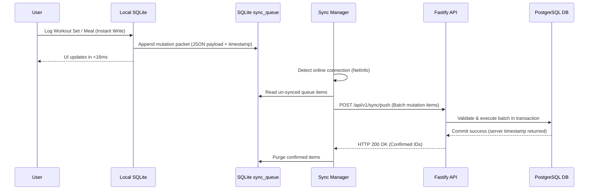

# FITLIFE OS — TECHNOLOGY STACK EVALUATION & ARCHITECTURAL RECOMMENDATION

---

## 1. Executive Evaluation Summary

| Subsystem | Proposed Technology | Evaluation Status | Recommendation |
|---|---|---|---|
| **Mobile Client** | React Native (Expo SDK 51+ with `expo prebuild`) | **Validated** | Use Expo Prebuild with clean F-Droid Config Plugin |
| **Local Database** | Expo SQLite (Modern async API) | **Validated** | Use Expo SQLite with WAL mode & custom migration runner |
| **State Management** | Zustand + TanStack Query | **Validated** | Zustand for client state; TanStack Query for sync caching |
| **Form Handling** | React Hook Form + Zod | **Validated** | Zero runtime bloat, typesafe validation across monorepo |
| **Backend API** | Fastify + TypeScript | **Validated** | High throughput, low overhead, native TypeScript support |
| **Backend Database** | PostgreSQL 16+ with Kysely | **Validated** | Robust ACID compliance, type-safe SQL queries, zero ORM bloat |
| **Monorepo Harness** | Turborepo + npm workspaces | **Validated** | Fast incremental builds, shared packages (`domain`, `shared-types`, `validation`) |
| **Distribution** | F-Droid + Self-Hosted APK | **Validated** | 100% Free Software compliant, zero proprietary GMS blobs |

---

## 2. In-Depth Mobile Framework Evaluation: React Native + Expo vs. F-Droid

### 2.1 The F-Droid Compatibility Challenge
F-Droid has some of the strictest packaging requirements in the open-source software ecosystem:
1. **Zero Proprietary SDKs:** Release builds cannot include closed-source binaries (e.g., Google Play Services `play-services-base`, Firebase, Google Analytics, Facebook SDK).
2. **Reproducible Builds:** The app must be buildable entirely from source code in an offline, isolated environment on the official F-Droid Debian build server using standard Gradle and open JDKs.
3. **No Dynamic Binary Downloads:** Build scripts cannot fetch unverified binary blobs during compilation.

### 2.2 Why "Expo Prebuild" Solves the F-Droid Dilemma
A common misconception is that Expo apps cannot be published on F-Droid. This is only true for *Expo Go* or apps dependent on proprietary Expo Cloud EAS services.

By using **`expo prebuild` (Continuous Native Generation)**:
- The mobile application's native `android/` directory is deterministically generated from `app.json` and Config Plugins.
- We develop a dedicated **F-Droid Config Plugin** (`plugins/withFDroidClean.js`) that:
  1. Strips all Google Mobile Services dependencies (`com.google.android.gms:*`).
  2. Sets `expo-notifications` into pure local-notification mode (disabling FCM push receiver declarations in `AndroidManifest.xml`).
  3. Ensures Gradle uses standard open-source Maven repositories.
  4. Configures the open-source **Hermes** JavaScript engine (Apache 2.0).
- This produces a 100% clean, standard Android Gradle project that compiles seamlessly under standard open toolchains without anti-feature flags.

---

## 3. Backend Architecture: Fastify + PostgreSQL

### 3.1 Fastify Over Express / NestJS
- **Performance & Overhead:** Fastify delivers up to $2\times - 3\times$ lower latency and higher request throughput than Express due to its internal Radix Tree router and optimized JSON serialization.
- **Type Safety:** Seamless integration with TypeScript and shared Zod schemas (`packages/validation`).
- **Self-Hosting Simplicity:** Minimal memory footprint ($\le 60\text{ MB}$ RSS idle), making it trivial to run on a \$5/month VPS, Raspberry Pi, or home server via Docker Compose.

### 3.2 Kysely Over Heavy ORMs (Prisma / TypeORM)
- Traditional heavy ORMs introduce significant runtime overhead, complex query generation bugs, and cold-start latency.
- **Kysely** is a zero-dependency, pure TypeScript query builder that compiles down to raw, optimized SQL while offering end-to-end type safety directly derived from the PostgreSQL database schema.

---

## 4. Local Database & Offline Synchronization Engine

### 4.1 Expo SQLite Architecture
- Uses the standard, rock-solid, embedded SQLite C library.
- Configured with `PRAGMA journal_mode = WAL;` (Write-Ahead Logging) and `PRAGMA foreign_keys = ON;` for high-concurrency read/write transactions without blocking the UI thread.
- Migrations are tracked via an internal `_migrations` table executing linear, reversible SQL patches.

### 4.2 Sync Algorithm: Lamport-Timestamped Delta Queue

This ensures that network failures, dropped packets, or app termination never destroy user data.

---

## 5. Indian Food Taxonomy Integration

To provide authentic, accurate nutritional tracking for Indian users:
1. **Primary Dataset:** Ingestion of the official **ICMR - National Institute of Nutrition (NIN) Indian Food Composition Tables (IFCT 2017)**.
2. **Key Nutrient Profiling:** Covers energy (kcal), available carbohydrates, dietary fiber, total protein, total fat, and essential micronutrients (iron, calcium).
3. **Household Measure Conversion Engine:**
   - Standardizes vernacular and domestic portion sizes (`katori`, `cup`, `piece`, `tablespoon`, `roti`) with exact gram conversions.
   - Built-in oil/ghee addition calculator for accurate cooking medium adjustment.
